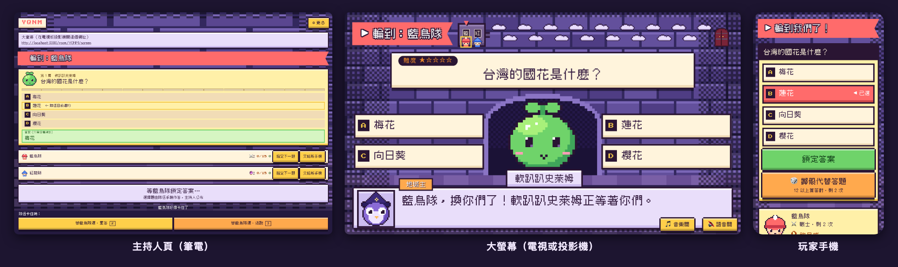

[繁體中文](README.md) | English

# Critical Answer（致命答題）

A D&D-style dungeon quiz party game. The name is a pun on *Critical Hit*. The host leads the teams through monster rooms and a boss fight on a big screen; players join on their phones, answer questions and collect points.



## What you need

- **One laptop**: for the host, to open the host page. It is also the computer that runs the game (when you play locally or on a LAN).
- **One big screen**: a TV or projector that shows the big-screen page, so everyone sees the questions and the map together.
- **One phone per team**: scan the QR code to join, up to 8 teams.
- **No API key needed**: narration uses scripted lines by default. If you want Claude to write the narration live, the host pastes their own Anthropic key (see the [hosting guide](docs/hosting.en.md#ai-narration)).

## Quick start

### Install it yourself

Requires Node.js 22.18 or later (`.nvmrc`).

```bash
git clone https://github.com/chihgeorge/critical-answer.git
cd critical-answer
npm install
npm run dev
```

`npm run dev` starts both Next.js (`http://localhost:3000`) and the room server (`localhost:8787`). Open `http://localhost:3000` and press 「主持遊戲」 (Host a game) to open a room.

### Let phones join (LAN playtest)

Phones cannot reach the computer's `localhost`. Connect the phones and the computer to the same Wi-Fi, then:

```bash
npm run playtest        # builds the production version, starts it, and prints the URL phones can open (web 3100, room server 1998)
npm run playtest:stop
```

If the phones cannot open the page, check whether the macOS firewall blocks incoming connections to node.

### Let an AI install it

Paste the text below into an AI that can use a terminal, such as Claude Code or Codex:

```text
Please install and start Critical Answer on this computer:
https://github.com/chihgeorge/critical-answer

Goal: it runs locally, and phones on the same Wi-Fi can join.
1. First read README.md, CLAUDE.md, package.json and .dev.vars.example; keep any changes I have not committed.
2. Use Node.js 22.18 or later, run npm install, then use npm run dev to confirm the front end (3000) and the room server (8787) both start.
3. Use npm run playtest to start the LAN version, and tell me the URL to open on the phones.
4. Use the default scripted narration; do not set any paid API key.
5. Confirm: a room opens, the big screen stays in sync, and a phone can join and answer one question.
At the end, tell me the start and stop commands, the URLs, and anything not finished yet.

Only when I say I want a public deployment, follow docs/deployment.md to set up my own Vercel and Cloudflare.
Put keys only in private local settings or platform secrets, never in variables that start with NEXT_PUBLIC_.
```

### Public deployment

To let people outside your network play, put the front end on Vercel and the room server on Cloudflare. See the [deployment guide](docs/deployment.en.md) for the steps.

## How to run it on the day

| Stage | Host (laptop) | Big screen | Players (phones) |
| --- | --- | --- | --- |
| Before the event | Check the question bank answers, test the connection | Open the big-screen URL on the host page, test the volume | Get the phones online |
| Gathering | On the home page, press 「主持遊戲」 (Host a game) to open a room | Shows the QR code and the 4-character room code | Each team scans the QR code to join and picks a class |
| Start | Press 「開始遊戲」 (Start game) to play the how-to-play intro | Plays the 4-page how-to-play intro, then shows the initiative roll's order | Watch the big screen, then roll initiative on the phone |
| Each question | Multiple choice and sort: press 「公布答案」 (Reveal answer) (key `1`); fill-in: judge right or wrong | Question, dice, result | Multiple choice: lock in an answer; sort: drag the items into order, then lock; fill-in: roll persuasion first, then type |
| Wrap-up | The boss falls or you press 「結束冒險」 (End adventure); you can press 「再玩一場」 (Play again) | Podium and epilogue (when a boss with a dish falls, the boss is cooked and served first) | See who has the most reward points |

The big-screen URL is at the top of the host page. For keyboard controls, switching phones and recovering from disconnects, see the [hosting guide](docs/hosting.en.md).

## The rules in one minute

- **Take turns**: at the start each team rolls a d20 on its phone (initiative roll); the highest goes first, and the teams answer in that order all game. Each room has one monster; answer correctly to defeat it, earn reward points and move into the next room.
- **Wrong answer**: choose 「重答」 (Retry) to answer the same question again, or flee to swap it for one a level easier: 「逃跑・同房」 (Flee, same room) keeps the same monster, 「逃跑・換房」 (Flee, switch room) brings another monster (the progress does not change).
- **Boss room**: once the progress points from correct answers reach 15, you enter the boss room; after one team goes in, every other team follows on its next correct answer. The boss's HP is shared; each hit is worth 10 points, and the final blow adds 4 d20s.
- **Dice**: a correct multiple-choice or sort answer rolls a crit die; a 20 gives half the reward points again. Before a fill-in answer you roll a persuasion check; pass it and you see the first character of the answer. The default question bank is all multiple choice, so no persuasion checks are rolled.
- **Classes**: the Warrior rolls dice instead of answering, the Mage removes wrong options, reveals the first character or a sort question's first item, the Cleric answers again after a wrong answer, the Thief's sneak attack gives 1.5× the reward points for that question, and the Chef (passive) gets 15% more on every gain.
- **Winning**: the team with the most reward points wins; a tie in the top three is settled by rolling d20s. The team that defeats the boss is not always the champion.

For the full rules, every number and every exception, see the [full rules](docs/rules.en.md).

## Docs

| Doc | Contents |
| --- | --- |
| [Full rules](docs/rules.en.md) | Judging, multiple choice, sort questions, persuasion checks, the boss, scoring, classes, monsters into dishes |
| [Hosting guide](docs/hosting.en.md) | Opening a room, how-to-play intro, manual pacing, big screen, AI narration, when things go wrong, known limits |
| [Deployment guide](docs/deployment.en.md) | First deployment, settings overview, keys, R2, deployment order |
| [Question bank guide](docs/question-bank.en.md) | Default question bank, question bank editor, how to recover when the bank is stuck |
| [Development guide](docs/development.en.md) | Tech stack, commands, tests, versions and releases, project structure |

Design records are in [docs/designs/](docs/designs/), pixel design rules in [DESIGN.md](DESIGN.md), deferred work in [TODOS.md](TODOS.md), and the changes in each version in [CHANGELOG.md](CHANGELOG.md).

## Roadmap

Done: big screen, question bank and question bank editor, scripted and AI narration, voice narration, sound effects and background music, live map, five classes, crit die, persuasion checks, monsters into dishes, production deployment. The next focus is the **second live playtest**: checking whether, with atmosphere added, the game is more fun than the first round. Full designs are in [docs/designs/critical-answer-iteration-2.md](docs/designs/critical-answer-iteration-2.md) (second round) and [docs/designs/critical-answer-party-game.md](docs/designs/critical-answer-party-game.md) (first round).

## License

[MIT](LICENSE). If you find a security problem, report it privately as described in [SECURITY.en.md](SECURITY.en.md).
