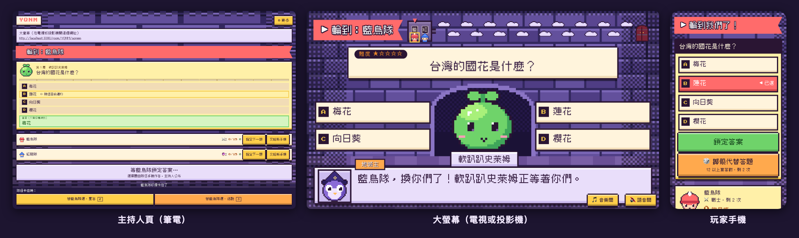

繁體中文 | [English](README.en.md)

# Critical Answer（致命答題）

D&D 風格的地城問答派對遊戲，名字是 *Critical Hit*（爆擊）的諧音梗。主持人用大螢幕帶隊伍闖怪物房、挑戰首領；玩家用手機加入、答題和累積分數。



## 你需要準備什麼

- **一台筆電**：主持人用，開主持人頁；也是跑遊戲的電腦（本機或區網試玩時）。
- **一個大螢幕**：電視或投影機，開大螢幕頁，所有人一起看題目和地圖。
- **每隊一支手機**：掃 QR code 加入，最多 8 隊。
- **不用 API key**：旁白預設是腳本句。想讓 Claude 即時寫旁白，主持人再貼自己的 Anthropic key（見[主持指南](docs/hosting.md#ai-旁白)）。

## 快速開始

### 自己安裝

需要 Node.js 22.18 以上（`.nvmrc`）。

```bash
git clone https://github.com/chihgeorge/critical-answer.git
cd critical-answer
npm install
npm run dev
```

`npm run dev` 同時啟動 Next.js（`http://localhost:3000`）和房間伺服器（`localhost:8787`）。打開 `http://localhost:3000` 按「主持遊戲」就能開房。

### 讓手機加入（區網試玩）

手機連不到電腦的 `localhost`。手機和電腦連同一個 Wi-Fi，然後：

```bash
npm run playtest        # 建置正式版、啟動，最後印出手機能開的網址（網頁 3100、房間伺服器 1998）
npm run playtest:stop
```

手機打不開時，看看 macOS 防火牆有沒有擋 node 的連入連線。

### 交給 AI 安裝

把下面這段貼給 Claude Code、Codex 這類會操作終端機的 AI：

```text
請幫我在這台電腦安裝並啟動 Critical Answer：
https://github.com/chihgeorge/critical-answer

目標：本機跑起來，而且同一個 Wi-Fi 的手機能加入。
1. 先讀 README.md、CLAUDE.md、package.json 和 .dev.vars.example；保留我還沒提交的修改。
2. 用 Node.js 22.18 以上，npm install，再用 npm run dev 確認前端（3000）和房間伺服器（8787）都起來。
3. 用 npm run playtest 啟動區網版，告訴我手機要開的網址。
4. 用預設的腳本旁白，不要設任何付費的 API key。
5. 確認：能開房、大螢幕畫面會同步、手機能加入並答完一題。
最後告訴我啟動和停止的指令、網址，以及還沒完成的事。

只有我說要公開部署時，才照 docs/deployment.md 設定我自己的 Vercel 和 Cloudflare。
金鑰只放本機的私密設定或平台的 secret，不要放進 NEXT_PUBLIC_ 開頭的變數。
```

### 公開部署

要讓外面的人也能玩，前端放 Vercel、房間伺服器放 Cloudflare，步驟見[部署指南](docs/deployment.md)。

## 活動當天怎麼玩

| 階段 | 主持人（筆電） | 大螢幕 | 玩家（手機） |
| --- | --- | --- | --- |
| 開場前 | 覆核題庫答案、測試連線 | 開 `/room/<代碼>/screen`，測音量 | 手機連上網路 |
| 集合 | 首頁按「主持遊戲」開房 | 顯示 QR code 和 4 碼房間代碼 | 每隊掃 QR 加入、選職業 |
| 開始 | 按「開始遊戲」，播玩法說明 | 播 4 頁玩法說明 | 看大螢幕 |
| 每一題 | 選擇題和排序題按「公布答案」（鍵盤 `1`）；填空題判對錯 | 題目、骰子、結果 | 選擇題鎖定答案；排序題拖拉排好再鎖定；填空題先擲說服再打字 |
| 收尾 | 首領倒下或按「結束冒險」，可以「再玩一場」 | 頒獎台和後記（打倒有菜的首領時，先煮首領、上大菜） | 看誰的獎勵分最高 |

主持人頁最上方就是大螢幕的網址。鍵盤操作、換手機、斷線怎麼救見[主持指南](docs/hosting.md)。

## 一分鐘懂規則

- **輪流答題**：所有隊伍依固定順序輪流，每間房一隻怪物，答對就打倒牠、拿獎勵分、走進下一間。
- **答錯**：選「重答」再答同一題，或「逃跑」換一題簡單一級的。
- **首領房**：答對累積的進度分到 15 就進首領房；有一隊進去後，其他隊下一次答對就跟進。首領血量共用，打中一下 10 分，尾刀再加 4 顆 d20。
- **骰子**：選擇題和排序題答對擲暴擊骰，20 多拿一半獎勵分。填空題作答前擲說服檢定，過了看到答案第一個字。預設題庫全是選擇題，所以不會擲說服檢定。
- **職業**：戰士擲骰代替答題、法師刪錯誤選項、給第一個字或排序題的第一個項目、牧師答錯再答一次、盜賊偷襲讓這題獎勵分 ×1.5、廚師（被動）每次拿分多 15%。
- **勝負**：獎勵分最高的隊伍獲勝；前三名同分時擲 d20 比大小。打倒首領的隊伍不一定是冠軍。

完整規則、每個數字和例外見[完整規則](docs/rules.md)。

## 文件

| 文件 | 內容 |
| --- | --- |
| [完整規則](docs/rules.md) | 判定、選擇題、排序題、說服檢定、首領、計分、職業、怪物變料理 |
| [主持指南](docs/hosting.md) | 開房、玩法說明、大螢幕、AI 旁白、出狀況時、已知限制 |
| [部署指南](docs/deployment.md) | 第一次部署、設定一覽、金鑰、R2、部署順序 |
| [題庫指南](docs/question-bank.md) | 預設題庫、題庫編輯器、題庫卡住時怎麼救 |
| [開發指南](docs/development.md) | 技術棧、指令、測試、版本與 Release、專案結構 |

設計紀錄在 [docs/designs/](docs/designs/)，像素設計規則在 [DESIGN.md](DESIGN.md)，延後事項在 [TODOS.md](TODOS.md)，每一版的改動在 [CHANGELOG.md](CHANGELOG.md)。

## 路線圖

已完成：大螢幕、題庫與題庫編輯器、腳本與 AI 旁白、語音旁白、音效與背景音樂、活地圖、五個職業、暴擊骰、說服檢定、怪物變料理、正式部署。接下來的重點是**第二次真人測試**：驗證有氣氛之後是不是比第一輪好玩。完整設計見 [docs/designs/critical-answer-iteration-2.md](docs/designs/critical-answer-iteration-2.md)（第二輪）和 [docs/designs/critical-answer-party-game.md](docs/designs/critical-answer-party-game.md)（第一輪）。

## 授權

[MIT](LICENSE)。發現安全問題請照 [SECURITY.md](SECURITY.md) 私下回報。
