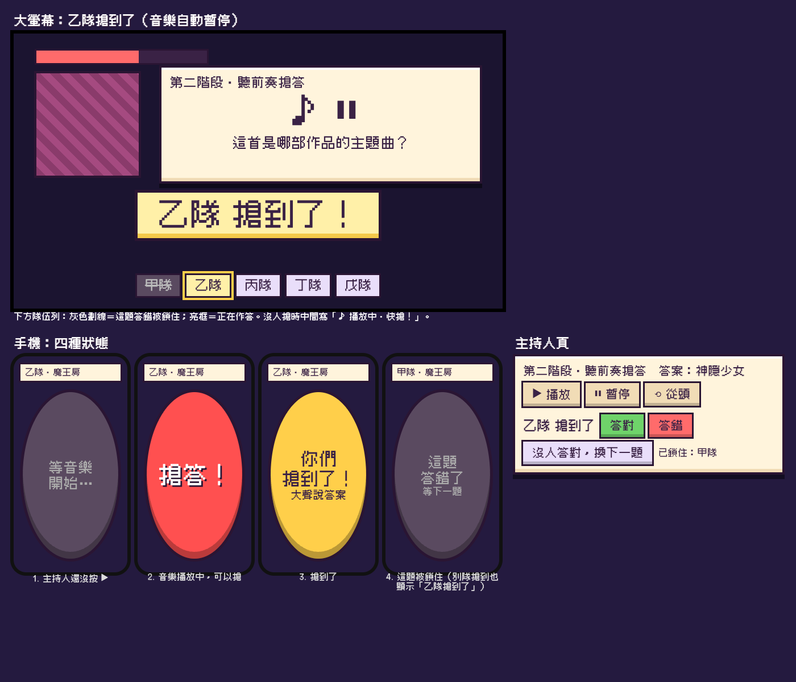

# 魔王搶答階段（boss buzzer phase）

Generated by /office-hours on 2026-11-07（站長 2026-11-08 的要求：「魔王關能不能多一個音樂題模式 用搶答的」）
Branch: claude/boss-music-buzzer-9ad1b0
Status: APPROVED（D1–D7 由站長逐題決定）
Mode: Builder
活動：2026-11-21，功能截止 2026-11-18

> e2e 只在 GitHub CI 跑，不要在本機跑 `npm run e2e`（見 CLAUDE.md, Testing）。

## 要做什麼

魔王的某個階段改成「搶答」：大螢幕放歌，所有隊伍一起搶，搶到的隊伍大聲講答案，主持人判答對／答錯。這是現有兩個功能的組合：

- 魔王分階段（`docs/designs/boss-phases.md`）：階段卡宣布新規則，正好拿來宣布「接下來是搶答」。
- 聽歌題（`docs/designs/youtube-questions.md`）：大螢幕藏畫面只放聲音，主持人頁 ▶ ⏸ ⟲ 控制，題庫可設播放區間。

## 決定

| # | 問題 | 決定 |
|---|---|---|
| D1 | 搶答何時出現 | 題庫的魔王**階段**多一個開關 `buzzer: true`，整個階段都是搶答。第一階段不能是搶答（只能從第二階段起），所以搶答一定由階段卡開場。 |
| D2 | 誰能搶 | 全員：搶答階段的階段卡一打開，還在一般房間的隊伍全部拉進魔王房（跟主持人「送進首領房」一樣），輪流暫停。 |
| D3 | 怎麼作答 | 搶到的隊伍口頭作答，主持人按「答對／答錯」。搶答階段的題目只能是填空題（`kind: "text"`），題庫會擋掉選擇題和排序題。 |
| D4 | 答錯的代價 | 這題這隊不能再搶，不扣分。所有在線隊伍都答錯，或主持人按「沒人答對，換下一題」，就換題：不公布答案，這題之後還可能再出現。 |
| D5 | 音樂 | 影片題要等主持人第一次按 ▶ 才開放搶答（不是影片的題目一出現就開放）。有人搶到，大螢幕自動暫停；答錯自動接著播。 |
| D6 | 傷害 | 搶對＝一般命中：扣 1 格血、拿命中獎勵（廚師 15% 照算），最後一擊照樣擲 4d20。搶答階段不用職業技能、說服檢定，牧師也不能祈禱；上一階段已經發動的盜賊偷襲會退回次數。 |
| D7 | 畫面 | 照草圖。大螢幕：「乙隊 搶到了！」大字＋下方隊伍列（灰色劃線＝這題鎖住、亮框＝作答中），沒人搶時「♪ 播放中・快搶！」。手機：一顆大圓鈕四種狀態。主持人頁：「乙隊 搶到了 [答對] [答錯]」與「沒人答對，換下一題」。 |

其他（Claude 依現有做法決定）：

- **誰先搶到**：房間（Durable Object）一次只處理一則訊息，先到房間的 `TEAM_BUZZ` 就贏。不做手機時間戳校正：現場同一個 Wi-Fi，延遲差距遠小於人的反應時間。
- **旁白**：搶到時不念。答對念現有的魔王命中台詞。答錯念新的短句（「某某隊答錯了！這題出局，其他隊快搶！」）：現有的失誤台詞會說「再試一次」，跟鎖住矛盾。全部答錯時念現有的「首領換題」台詞；主持人按「換下一題」不念。搶答階段的台詞不說「輪到誰」。
- **離線**：離線隊伍不能搶。搶到的隊伍斷線，搶答權放掉（不算答錯），音樂接著播，別隊可以再搶。「全部答錯」只算在線隊伍，而且只在主持人判答錯時檢查：最後一隊沒鎖住的斷線時，主持人按「換下一題」。
- **音樂**（/review 補）：搶答只暫停正在播的音樂，答錯或斷線時才接著播；主持人自己按的暫停（搶答前或搶答後按的都算）不會被答錯打開。換題時如果換回同一題（這階段只剩這題沒公布），所有隊伍都能再搶，已開放的影片保持開放。主持人在答案揭曉時按 ▶ 不會開放下一輪搶答。
- **每題作答倒數（#162）**：搶答階段不跑倒數。搶答本身就是比快，搶到的隊伍當場口頭作答。
- **紀錄（#155 game log）**：每次判定照樣經過 `answerQuestion`，所以回合數、命中次數照常記錄；不另外記搶答次數。
- **題庫格式**：`BANK_FORMAT` 升到 5；有搶答階段的題庫存成 5，舊版程式會拒絕覆寫，而不是把 `buzzer` 丟掉。

## 狀態與流程

`GameState.buzz?: { questionId; open?: true; teamId?; out: string[] }`，跟遊戲一起存檔，房間重啟後還在。

1. 階段卡打開（`enterNextBossPhase`）：新階段是搶答 → 所有隊伍 `inBoss`，`buzz` 清空。
2. 題目上大螢幕。影片題等主持人按 ▶（`HOST_MEDIA play` → `openBuzz`）；其他題目直接開放。
3. 手機送 `TEAM_BUZZ` → `buzzIn`：開放中、沒人持有、這隊在線且沒被鎖 → `buzz.teamId`＝這隊，輪到這隊（`currentTurnIndex`），大螢幕音樂暫停。
4. 主持人 `HOST_JUDGE`（現有）：
   - 答對 → 一般魔王命中，公布答案，下一題要重新按 ▶。
   - 答錯 → 這隊進 `out`，`teamId` 清掉，音樂接著播；在線隊伍全在 `out` → 換題（不算公開）。
5. 主持人 `HOST_BUZZ_SKIP`（「沒人答對，換下一題」）→ 換題，同樣不公開。

## 不做（活動後再說）

- 手機端時間戳、延遲補償。
- 搶答時的職業技能。
- 選擇題／排序題的搶答。
- 第一階段就是搶答。
